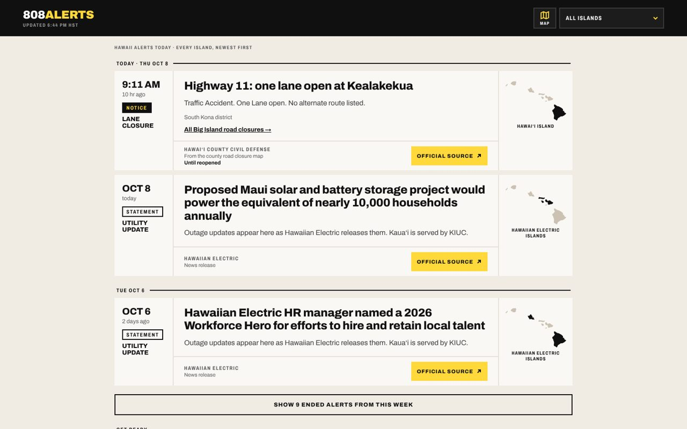

# 808 Alerts

Official Hawaiʻi emergency alerts in one feed: weather warnings, road closures, open shelters and power updates for every island, newest first.

**Live: [808alerts.com](https://808alerts.com)**



During a storm, the information people need is split across the National Weather Service, county emergency agencies and the power company, each with its own site and format. 808 Alerts pulls those official sources into a single chronological feed that works on a phone with a weak signal. Every card links straight back to the agency that issued it.

> 808 Alerts is an independent information aggregator. It is not an official alert system and never replaces county emergency management or 911.

## What it does

- **One feed for every island.** NWS alerts, Hawaiʻi County road closures, open shelters and Hawaiian Electric releases, grouped by day. One island dropdown is the only control.
- **Warnings stay on top.** Active warnings pin above the chronological flow until they end, so newer statements cannot bury them.
- **Alerts are threaded.** NWS updates are joined into a single card with their history, and multi-zone alerts are grouped and split back out by area on the detail page.
- **A failed source is never shown as an empty one.** If a feed is down, the page says so, shows the last good data and labels its age.
- **Shareable alert pages.** Every alert gets a real URL that keeps working after the alert is updated.
- **Server-rendered for search and link previews.** A Cloudflare Pages Function renders live alerts into the HTML, with a strict time budget so a slow feed can never stall the page.
- **Preparation guides** for hurricanes, tsunamis, shelters and a kit checklist, with every phone number checked against the agency's own published page.

## Sources

| Source | Used for |
|---|---|
| [National Weather Service](https://www.weather.gov/hfo/) (`api.weather.gov`) | Active and recently ended alerts for Hawaiʻi |
| Hawaiʻi County Civil Defense | Road closures (last 7 days) and open shelters |
| Hawaiian Electric | Outage and utility news releases |

## Stack

- Static HTML, CSS and vanilla JavaScript, generated by a small build script (`tools/site/build.py`)
- Cloudflare Pages, deployed from `main` by GitHub Actions
- A Cloudflare Pages Function for server rendering, and a Cloudflare Worker (`worker/`) for the Hawaiian Electric feed
- Interactive storm map at [/map](https://808alerts.com/map/)

## Run it locally

```bash
python3 tools/site/build.py              # regenerate the feed pages
npx wrangler pages dev . --port 8808     # serve with the server-side function
```

Then open http://localhost:8808.

---

Built with ♥ by [shauna.digital](https://shauna.digital)
